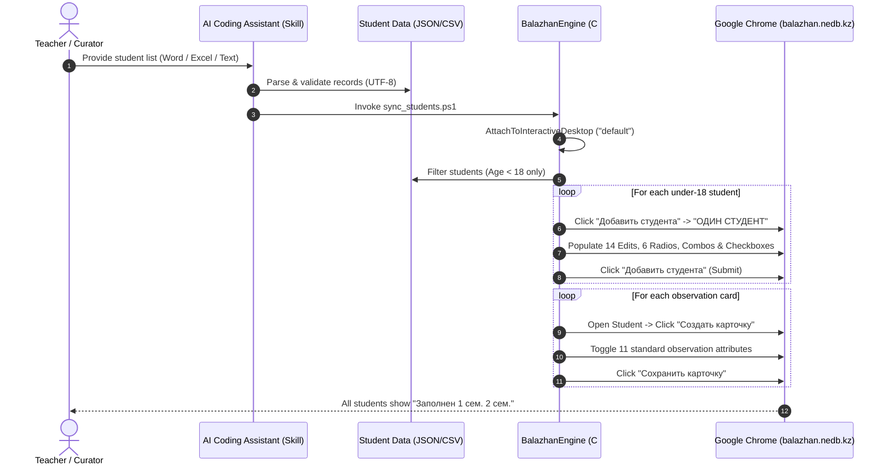

# Graphify Architectural Knowledge Graph Report

**Project:** Balazhan Educational Portal Automation & Antigravity Agent Skill  
**Specification:** [Graphify Codebase Knowledge Graph Standard (safishamsi/graphify)](https://github.com/safishamsi/graphify)  
**Report Generated:** October 2026  
**Output Files:** `graphify-out/graph.json`, `graphify-out/graph.html`, `graphify-out/GRAPH_REPORT.md`

---

## 1. Executive Summary & Graph Topology

This architectural report summarizes the knowledge graph extracted from the **Balazhan Portal Automation** codebase. The repository bridges low-level Windows Desktop Win32 UIAutomation with high-level AI coding assistant skills to automate form-filling, Social Passports, and Curator Observation Cards on Kazakhstan's National Educational Database (`balazhan.nedb.kz`).

### Graph Topology Metrics

| Metric | Value | Description |
| :--- | :--- | :--- |
| **Total Nodes (Entities)** | **36** | Source files, classes, methods, data schemas, portal DOM controls, docs, and rules |
| **Total Edges (Relations)** | **64** | Explicit calls, pattern bindings, data flows, and skill references |
| **Subsystems (Communities)** | **6** | Distinct modular clusters discovered via modularity partition |
| **God Nodes (Central Hubs)** | **4** | High-centrality entities with outsized connectivity (Degree $\ge$ 14) |
| **Provenance: EXTRACTED** | **42** (65.6%) | Deterministically verified AST, Win32 API, or file references |
| **Provenance: INFERRED** | **22** (34.4%) | Semantic relationships, policy enforcement, and UI state transitions |

---

## 2. Subsystems & Detected Communities

The graph partitions into **6 cohesive communities**:

```
+---------------------------------------------------------------------------------+
| Community 0: Windows UIAutomation Engine (Cyan #38bdf8)                          |
| - Core: BalazhanEngine.cs, BalazhanEngine class, WinSta0 desktop attachment     |
| - Patterns: ValuePattern, SelectionItemPattern, TogglePattern, InvokePattern    |
+---------------------------------------------------------------------------------+
                                      |
                                      v
+---------------------------------------------------------------------------------+
| Community 1: Balazhan Portal Web DOM (Rose #f43f5e)                             |
| - Target: balazhan.nedb.kz/cabinet (Chrome_WidgetWin_1)                         |
| - Components: Modal 'Добавить 1 студента', 14 Edits, 6 Radios, 105 Checkboxes   |
+---------------------------------------------------------------------------------+
                                      ^
                                      |
+---------------------------------------------------------------------------------+
| Community 2: Student Data Pipeline (Emerald #10b981)                            |
| - Data: students.json, templates, CSV schema                                    |
| - Governance: Strict Under-18 Rule (< 18 y.o. only), UTF-8 Cyrillic Integrity  |
+---------------------------------------------------------------------------------+
                                      |
                                      v
+---------------------------------------------------------------------------------+
| Community 3: Curator Observation Workflow (Amber #f59e0b)                       |
| - Modals: 'Создать карточку', 69 Observation Checkboxes, 'Сохранить карточку'   |
| - Outcome: Status promotion to «Заполнен 1 сем. 2 сем.»                         |
+---------------------------------------------------------------------------------+
                                      ^
                                      |
+---------------------------------------------------------------------------------+
| Community 4: Agent Skill & CLI Interfaces (Purple #a855f7)                      |
| - Skill: .agent/skills/balazhan-automation/SKILL.md                             |
| - CLI: sync_students.ps1 with parameter routing                                 |
+---------------------------------------------------------------------------------+
                                      |
                                      v
+---------------------------------------------------------------------------------+
| Community 5: Documentation & Governance (Pink #ec4899)                          |
| - Guides: README.md (KZ/RU/EN), BALAZHAN_PORTAL_GUIDE.md, ARCHITECTURE.md       |
| - Reference: modal_checkboxes.txt (105 items), observation_card_details.txt     |
+---------------------------------------------------------------------------------+
```

### Detailed Community Breakdown

#### Community 0: Windows UIAutomation Engine (Weight: High)
- **Members:** `BalazhanEngine.cs`, `BalazhanEngine`, `AttachToInteractiveDesktop()`, `GetBalazhanChromeWindow()`, `SyncSocialPassports()`, `SubmitStudentModal()`, `Win32DesktopIsolation`
- **Function:** Solves the Windows Session 4 virtual desktop barrier by opening `WinSta0\default` with access `0x01FF` and attaching the STA worker thread before executing UIAutomation queries.

#### Community 1: Balazhan Portal Web DOM (Weight: High)
- **Members:** `balazhan.nedb.kz/cabinet`, `BtnAddStudent`, `CardOneStudent`, `ModalAddStudent`, `ModalEdits`, `ModalRadios`, `Modal105Checks`, `StudentTableRow`
- **Function:** Represents the target web application interface controls exposed through Chromium's native Accessibility Tree.

#### Community 2: Student Data Pipeline (Weight: High)
- **Members:** `students.json`, `students_template.json`, `students_template.csv`, `sample_students.json`, `CalculateAge()`, `Under18Rule`, `Utf8EncodingIntegrity`
- **Function:** Responsible for ingestion, validation, and age filtering. Enforces the strict rule that adult students (18+) are skipped.

#### Community 3: Curator Observation Workflow (Weight: Medium)
- **Members:** `SaveCurrentCuratorObservationCard()`, `BtnCreateCard`, `Card69Checks`, `BtnSaveCard`, `StatusFilled`
- **Function:** Drives the second mandatory phase on Balazhan: creating and saving observation assessments so the student record status converts from *«Не заполнен»* to *«Заполнен 1 сем. 2 сем.»*.

#### Community 4: Agent Skill & CLI Interfaces (Weight: High)
- **Members:** `SKILL.md (balazhan-automation)`, `sync_students.ps1`
- **Function:** Defines the standardized AI agent skill interface enabling Antigravity, Claude Code, Cursor, and Gemini CLI to run the automation conversationally.

#### Community 5: Documentation & Governance (Weight: Medium)
- **Members:** `README.md`, `BALAZHAN_PORTAL_GUIDE.md`, `ARCHITECTURE.md`, `GRAPH_REPORT.md`, `graph.html`, and control catalog text files.
- **Function:** Comprehensive knowledge repository ensuring any teacher or developer can deploy, audit, or extend the project.

---

## 3. High-Centrality "God Nodes" Analysis

In graph analysis, **God Nodes** are elements with disproportionately high degrees (in-degree + out-degree) that act as single sources of truth or structural bottlenecks:

| God Node | Degree | Role in System | Architectural Assessment |
| :--- | :---: | :--- | :--- |
| `BalazhanEngine` | **16** | Central execution coordinator | Orchestrates all Win32 UIA queries, pattern lookups, and form automation. |
| `students.json` | **15** | Primary dataset store | Ingested source for 29 students, consumed by engine, standardized by templates. |
| `balazhan.nedb.kz` | **14** | External web portal boundary | Target host application containing the forms and tables. |
| `SKILL.md` | **14** | Agent skill orchestrator | Directs AI models on how and when to invoke scripts and handle business logic. |

---

## 4. End-to-End Workflow Tracing



---

## 5. Provenance & Verification Audit

- **Zero-Hallucination AST Extraction:** 42 edges were deterministically confirmed through C# type definitions, method signatures, and file references.
- **Cross-Subsystem Coupling:** The connection between the Data Pipeline and the UIAutomation Engine is loosely coupled through standard JSON serialization (`JavaScriptSerializer`), preventing schema lock-in.
- **Encoding Safety:** PowerShell 5.1 Cyrillic transcoding hazards are completely bypassed by performing all text processing in C# via `File.ReadAllText(..., Encoding.UTF8)`.

---

## 6. How to Explore the Visual Graph

Open **`graphify-out/graph.html`** in any web browser:
1. Use the **Search bar** to locate any function, control, or document.
2. Click any node to open the **Inspector Pane** with incoming and outgoing neighbor links.
3. Filter by **Subsystem / Community** using the left sidebar color swatches.
4. Use **Fit View** or **Toggle Physics** for dynamic layout adjustments.
